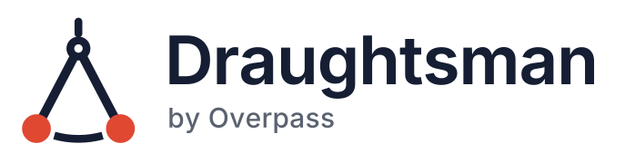

<p align="center">
  
</p>

# Draughtsman

**Agent-native, self-hosted diagramming.** A Draughtsman diagram is a typed graph, not a picture: nodes and edges with kinds, ports and properties, stored in a database you run. The graph has a lossless text form (the DSL) that people and AI agents can read, diff and write, and a built-in MCP server so an agent can create, amend, critique and render diagrams directly. The canvas editor, the exports and the renders are all drawn from that one model. It runs on your own server, and nothing leaves your network unless you switch on an optional feature that says so.

- **Typed graph model**: four document types (flowchart, architecture, freeform, sequence) with kind vocabularies an agent can ask for with `get_schema`.
- **Lossless text DSL**: print a diagram, edit the text, parse it back with nothing lost. Diffs read in sentences, so diagrams belong in git.
- **MCP server**: eight tools over HTTP (`/mcp`) or stdio (`draughtsman mcp --stdio`).
- **Self-hosted**: one executable (or one container), SQLite by default, Postgres if you prefer. No account with us, no phone-home.

## Quick start

You need a machine that can run Docker, or one of the release archives. About five minutes.

### Docker

No sign-up, no account with us, nothing to request. No image is published to a registry yet, so build it from this repository.
The quickest way is [`docker-compose.yml`](docker-compose.yml):

```sh
git clone https://github.com/overpassapps/draughtsman.git && cd draughtsman
docker compose up -d --build
docker compose logs draughtsman | grep "setup code"
```

Or by hand, with a folder on the host for the data:

```sh
docker build -t draughtsman:local .

mkdir -p draughtsman-data && sudo chown -R 10001:10001 draughtsman-data && sudo chmod 700 draughtsman-data   # Linux; Docker Desktop needs no chown
docker run -d --name draughtsman --restart unless-stopped \
  -p 127.0.0.1:5180:5180 \
  -v "$(pwd)/draughtsman-data:/data" \
  draughtsman:local

curl -s http://127.0.0.1:5180/api/health      # {"status":"ok"}
docker logs draughtsman 2>&1 | grep "setup code"
```

Open <http://localhost:5180>, enter the one-time setup code from the log, and create the first administrator. The port is published to loopback only; put a reverse proxy in front for anyone else ([`docs/deployment.md`](docs/deployment.md)). Full Docker guide: [`docs/install-docker.md`](docs/install-docker.md).

### Release archive

Archives for macOS (Apple silicon and Intel), Linux (x64, arm64) and Windows (x64, arm64) are one folder with nothing else to install: no .NET, no Node. No release has been cut yet, so there is no download to link to; `scripts/publish.sh <platform>` builds an archive from source, and [`docs/install.md`](docs/install.md) covers unpacking, running as a service and checksums.

```sh
tar -xzf draughtsman-0.1.0-linux-x64.tar.gz && cd draughtsman-0.1.0-linux-x64
./draughtsman                      # http://localhost:5180
```

### From source

.NET SDK 10.0.x (pinned in `global.json`) and Node 22.12 or later:

```sh
dotnet run --project src/Draughtsman.Server        # http://localhost:5180
```

The web app is served from `web/dist` when it exists (`cd web && npm ci && npm run build`). [`CONTRIBUTING.md`](CONTRIBUTING.md) has the whole developer loop.

## Connect an AI agent over MCP

Sign in, open **Tokens** in the top bar, create a token (the secret, `dst_…`, is shown once), then:

```sh
# a running server, over HTTP (Claude Code shown; any MCP client that speaks streamable HTTP works)
claude mcp add --transport http draughtsman http://127.0.0.1:5180/mcp --header "Authorization: Bearer dst_…"

# the same machine and data folder, over stdio: no token, no port
claude mcp add draughtsman -e DRAUGHTSMAN_DATA=/path/to/data -- /path/to/draughtsman mcp --stdio
```

The tools are `list_documents`, `read_document`, `create_document`, `patch_document`, `render_document`, `diff_documents`, `critique_document` and `get_schema`. A token can be read-only. [`SKILL.md`](SKILL.md) is a ready-made agent skill that teaches the DSL and the tools; the HTTP contract is in [`docs/api.md`](docs/api.md).

## What is built

- **Editor**: a canvas with pan, zoom, marquee select, snapping, undo and redo, connectors that route around shapes (orthogonal, straight, curved), ports, containers and grouping, a styling panel, a text pane (DSL or Mermaid beside the canvas), pen and touch, and live merging of an agent's edits into the open diagram.
- **Diagram types and shapes**: flowchart (ISO 5807 symbols, BPMN, swimlanes), architecture (generic tech icons, org chart, UML class and interface), sequence (edited by message order, with fragments and notes), freeform, UML state shapes, database tables with column-to-column connectors, and basic shapes.
- **Import**: Mermaid (flowchart and sequence, plus `erDiagram`), SQL DDL (T-SQL, PostgreSQL, MySQL, SQLite), draw.io, and Visio `.vsdx` (which also covers Lucidchart via its Visio export).
- **Export**: PNG and SVG in the browser, PDF from the browser's print dialog (or server-side through an optional Chromium component), DSL, JSON, Mermaid, SQL, and a fly-through exported as one self-contained HTML file.
- **Fly-through**: a camera path over a diagram, saved in the document and played full screen with captions.
- **For teams**: local accounts (Administrator and Editor), API tokens, a recycle bin, named versions with compare and restore, a critique panel, thumbnails, admin pages for branding, themes, AI and email settings, and backup and restore from the command line.
- **Optional AI**: bring your own model (Ollama, any OpenAI-compatible endpoint, Anthropic, Azure OpenAI) for **Generate from text** and **Diagram to document**. Off unless an administrator configures it; with a local Ollama nothing leaves your network.
- **Operations**: SQLite or Postgres, a Docker image, service installers for systemd, launchd and Windows, `draughtsman doctor` and `config check`, upgrade safety checks with automatic rollback of a failed SQLite migration, and an air-gapped install path ([`docs/air-gapped.md`](docs/air-gapped.md), [`docs/data-flow.md`](docs/data-flow.md)).

The long-form version, with configuration, is [`docs/status.md`](docs/status.md).

## Not built yet

We would rather you heard it here first:

- Single sign-on (OIDC, SAML) and workspaces beyond `default`. Sign-in is local only.
- A Viewer role or per-document permissions. Every signed-in user can read every diagram, and an Editor can change any of them.
- Real-time multi-user editing. The open editor polls and merges newer versions, and a stale save is refused rather than overwritten.
- A published container image and published release archives. You build both from source for now, and archives are not yet code-signed or notarised.
- SQL Server storage (SQLite and Postgres are supported).
- A PDF renderer that needs no extra install on the server: server-side PDF needs the optional Chromium component, and `render_document` cannot return PNG.
- Per-kind theme colours for BPMN shapes, and server-side styling of edge kinds (the server render draws a BPMN message flow as a plain arrow).
- Fly-through video or GIF export; BPMN compensation, loop and multi-instance markers and choreography diagrams.
- Automatic clean-up of orphaned uploaded images, and pruning of the security event log.
- Windows is a release target with its own CI leg, but the Windows archive and `service install` are less proven than the Linux and macOS ones.

The full list of known limitations is in [`CHANGELOG.md`](CHANGELOG.md).

## Documentation

Full documentation: **<https://draughtsman.overpass.co.uk/docs/>**. The same pages are in [`docs/`](docs/index.md) in this repository, alongside the [build specification](docs/spec/build-spec-v0.1.md), the [architecture decisions](docs/adr/), the [document schema](docs/schema/document.schema.json) and the [DSL grammar](docs/spec/dsl.md).

## Licence

Draughtsman is free software, released under the **GNU Affero General Public Licence v3.0 only** ([`LICENSE`](LICENSE)). Copyright © Overpass Limited. You can use it, change it and fork it; if you run a modified version as a network service you must offer its source to the people using it.

If the AGPL does not suit you, Overpass also offers Draughtsman under a **commercial licence** ([`COMMERCIAL-LICENSE.md`](COMMERCIAL-LICENSE.md)). It lets your organisation change Draughtsman and connect it to your own systems for internal use, and keep those changes private, without the AGPL's duty to offer source to network users. It costs **£1,500** one-off for a team of up to 50 people, or **£3,000** one-off with no limit on people. Each includes 12 months of updates and email support, and renewing updates costs 25% of list a year. It covers running Draughtsman inside your own organisation; to embed it in a product or service for others, ask about a separate agreement. To buy or ask, write to **draughtsman@overpass.co.uk**.

**Buying a commercial licence.** Commercial licences are bought by email: write to **draughtsman@overpass.co.uk** with your organisation's name and the tier you want, and we reply with an order to confirm and an invoice. The licence text is [`COMMERCIAL-LICENSE.md`](COMMERCIAL-LICENSE.md); the version in force when you buy is the one you accept.

Third-party components keep their own licences: see [`THIRD-PARTY-NOTICES.txt`](THIRD-PARTY-NOTICES.txt).

## Contributing

Bug reports, ideas and pull requests are welcome. Read [`CONTRIBUTING.md`](CONTRIBUTING.md) first. Outside contributions need a signed-off [Contributor Licence Agreement](CLA.md) so that Overpass Limited can keep offering commercial licences. Everyone taking part is expected to follow the [Code of Conduct](CODE_OF_CONDUCT.md). For questions, use GitHub Discussions rather than issues.

## Support the project

Draughtsman is built and maintained by Overpass. If it saves you time, you can sponsor the work at <https://github.com/sponsors/overpassapps>.

## Security

Please report vulnerabilities privately to **draughtsman@overpass.co.uk**, not in a public issue. See [`SECURITY.md`](SECURITY.md) for scope, timescales and the security model.

---

Made by [Overpass](https://overpass.co.uk).
