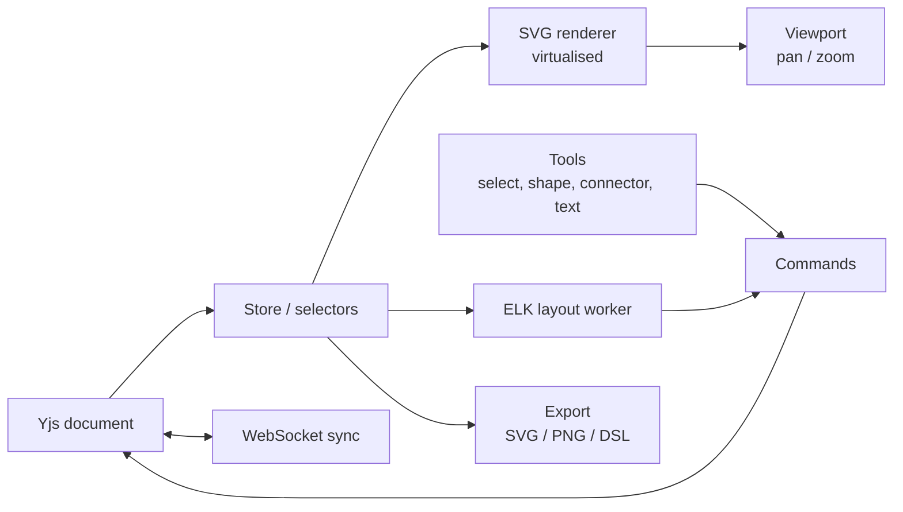
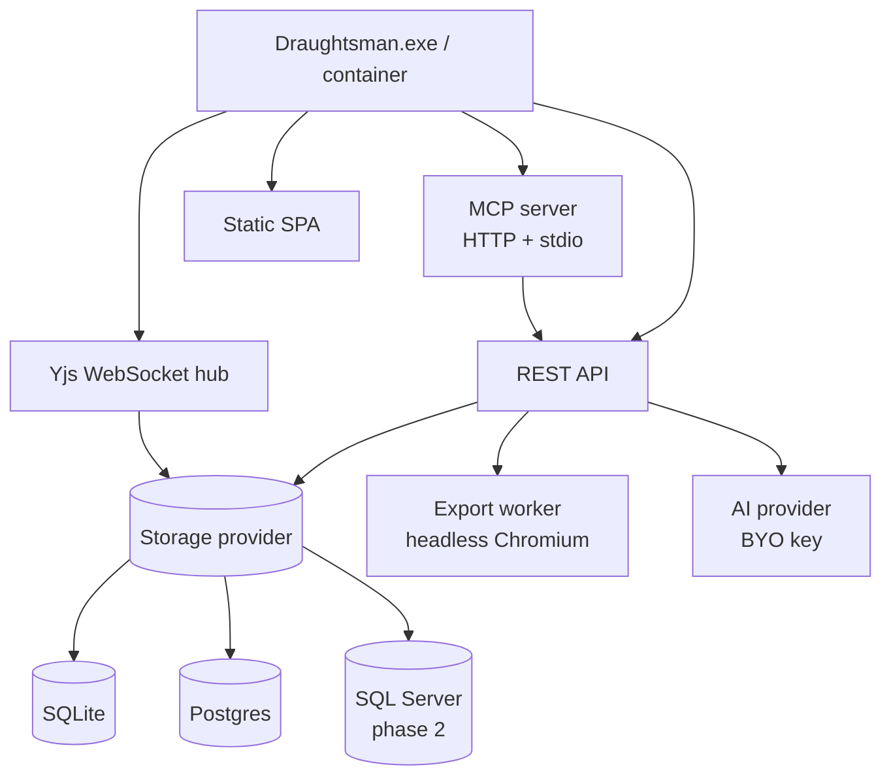

# Draughtsman — Build Spec v0.1

2026-09-20 · @Someone

## 1. Purpose

Draughtsman is a web-based, self-hosted diagramming tool whose diagrams are typed graphs that AI agents can read and write. It is free software (AGPL-3.0-only). Working name.

**One-line position:** agent-native diagramming for teams that can't put their architecture in someone else's cloud.

**What it is not**

- Not a whiteboard (no sticky-note brainstorming, no infinite freehand). Structured diagrams only.
- Not a feature-parity project with the large diagramming suites. Excellent at a small set of diagram types beats mediocre at forty.
- Not a SaaS-first product. Self-hosting is the primary shape; a hosted instance is a convenience.

**Why a model:** most diagramming tools treat the picture as the product. Draughtsman treats the model as the product and the picture as a render. That is what makes the MCP server, lint, semantic diff and docs generation possible, and none of it is bolt-on-able to a geometry file format.

## 2. Product principles

Six rules every design and build decision is checked against.

1. **The model is the truth; the picture is a render.** Every diagram is a typed graph with a lossless text form. If a feature only works on pixels, it is the wrong feature.
2. **Yours, on your tin.** One binary or one container, no phone-home, no telemetry. Backup is copying a folder.
3. **Professional-grade drawing for the everyday case.** Snapping, connectors, alignment and text editing must feel as good as the established diagramming tools for flowcharts and architecture diagrams, or nobody stays long enough to find the agent features.
4. **Bring your own AI.** Anthropic, OpenAI, Azure OpenAI or a local Ollama endpoint. The project never pays for anyone's inference and air-gapped sites are not excluded.
5. **Skinnable by config, not by fork.** Brand, palette, logo and default diagram styles are runtime configuration an organisation's IT person can edit. Overpass red and black is just the shipped default.
6. **No seat limits.** Every build is the whole product: no user caps, no feature tiers, no licence file.

## 3. MVP scope and cut-lines

The MVP is a tool its maintainers can use as their everyday diagramming tool for a month, installed from one binary, with the MCP server working. Everything else is phase 2 or later.

| Area | In the MVP | Phase 2 | Later / maybe never |
| --- | --- | --- | --- |
| Diagram types | Flowchart, architecture (boxes, containers, arrows); third type ERD or sequence (open, section 13) | Sequence, state, org chart, swimlane process | BPMN, UML class, network topology, wireframes |
| Shapes | \~15 core shapes, containers, text, image, sticky note | Icon library (cloud providers, generic tech) | Custom shape libraries per client |
| Connectors | Orthogonal + straight, ports, labels, arrowheads, auto-route | Curved, waypoints, connector styles per kind | Connector-to-connector attachment |
| Editing | Select, move, resize, snap, align, distribute, undo/redo, copy/paste, keyboard shortcuts | Multi-page documents, layers, find/replace | Templates marketplace |
| Layout | ELK auto-layout on demand and for imports | Layout constraints, pinned nodes | Incremental layout while editing |
| Text format | Draughtsman DSL round-trip, Mermaid import | Mermaid export, Markdown outline export | D2 / PlantUML import |
| Export | PNG, SVG, PDF (single page), DSL, JSON | Multi-page PDF, PPTX slide per page | Visio (.vsdx) |
| Import | Mermaid, JSON | draw.io XML (geometry only) | Lucidchart via CSV/Visio |
| Users | Single user, local accounts | OIDC (Entra ID, Google), roles, document sharing | SAML, SCIM |
| Collaboration | Document model built on Yjs from day one, single editor | Realtime multi-editor, presence, comments | Version branching |
| Storage | SQLite, Postgres | SQL Server (Windows installations) | Object storage for attachments |
| AI | MCP server (read/create/patch/render/diff), text-to-diagram, diagram-to-docs | Lint, ask-the-diagram, code-to-diagram | Semantic diff narration, intent tidy |
| Packaging | Docker image; self-contained binaries for Linux, macOS and Windows | MSI + Windows service, Helm chart | Marketplace listings |
| Theming | Token file, Overpass default, client override file | Admin UI for theme, per-workspace themes | Per-document themes |

**Non-negotiable in MVP:** Yjs-based document model (retrofitting collaboration is misery), the DSL round-trip (the whole pitch), the storage abstraction (adding Postgres later must be a driver, not a rewrite), and the theme token system (retrofitting skinnability means touching every component).

## 4. Document model

A document is a typed graph: nodes, edges, and a small header. Containers are nodes with children. Semantics (`kind`) are separate from presentation (`shape`, `style`), so an agent can reason about a "database" without caring that it's drawn as a cylinder.

```markdown
Document
  id, schemaVersion, title, type            # type: flowchart | architecture | erd | freeform
  theme?                                    # document-level token overrides (optional)
  nodes[]
    id, kind, label                         # kind: process | decision | terminal | service | database | queue | actor | entity | note | container | ...
    shape                                   # originally: rectangle | rounded | diamond | cylinder | pill | hexagon | image | custom:<lib>/<name>; the accepted values are now those of the schema's `shape` pattern (docs/schema/document.schema.json), see the 2026-09-29 Amendments
    geometry { x, y, w, h, rotation }
    style   { fill, stroke, strokeWidth, textColor, font, dash }   # each optional; absent = inherit from theme + kind
    props   { }                             # free key/values: owner, url, ticket, columns[] for ERD entities, etc.
    parent?                                 # container node id
    ports[]?                                # named attachment points
  edges[]
    id, kind, label                         # kind: flow | data | dependency | association | relation(1:1 | 1:n | n:m)
    from { node, port? }, to { node, port? }
    routing { mode: orthogonal | straight | curved, waypoints[]? }
    style   { stroke, strokeWidth, dash, arrowStart, arrowEnd }
    props   { }
  meta { createdAt, updatedAt, createdBy, aiProvenance[]? }
```

**Rules**

- Ids are stable short strings (`n_api`, `e_12`), never regenerated on load, so agents and the DSL can reference them across edits.
- `kind` vocabularies are per document `type` and defined in a schema file the agent can read. Unknown kinds are allowed but flagged by lint.
- Style is sparse. A node with no style renders from theme tokens plus the kind's default, which is what makes re-skinning a document a no-op.
- `aiProvenance` records which agent/model created or last changed a node, for audit in regulated environments.
- The persisted form is a Yjs document (`Y.Map` per node/edge) with a JSON snapshot alongside for search, export and the MCP read path. JSON is the interchange format; Yjs is the storage and sync format.
- `schemaVersion` gates migrations. Every version bump ships a migration function; old files always open.

## 5. Text format (DSL) and interop

The DSL is the diagram an agent reads and writes. It round-trips the model losslessly, including ids and geometry, so a human can hand-edit it and an agent can patch it without wrecking the layout.

```markdown
draughtsman 1
type architecture
title "Order service"

node n_web   service  "Web app"        @ 40,40 320x80
node n_api   service  "Orders API"     @ 40,200 320x80  owner="platform"
node n_db    database "Postgres"       @ 40,360
node n_cache queue    "Redis"          @ 400,360
container c_vpc "VPC" { n_api n_db n_cache }

edge e_1 flow n_web -> n_api  "HTTPS"
edge e_2 data n_api -> n_db   "read/write"
edge e_3 data n_api -> n_cache
```

**Design rules**

- Geometry (`@ x,y wxh`) is optional on input. Missing geometry triggers ELK layout on import; on export it is always written so a round-trip is exact.
- Style is only written when it deviates from theme defaults, keeping agent-facing text short.
- Unknown properties are preserved verbatim (`props`), never dropped.
- One line per node or edge, so `git diff` and LLM patching both behave.
- A formal grammar lives in the repo (`dsl.grammar`) with a fuzz test that generates random documents and asserts `parse(print(doc)) == doc`.

**Interop**

| Format | Direction | Notes |
| --- | --- | --- |
| Mermaid (flowchart, erDiagram) | Import in MVP, export phase 2 | Every LLM already speaks it; this is how agents arrive with zero friction. Lossy on export (no geometry). |
| JSON (document model) | Both, MVP | The MCP wire format. |
| Markdown outline | Export, phase 2 | Headed list of containers, nodes and edges with labels and props, for pasting into a prompt or a design doc. |
| draw.io XML | Import, phase 2 | Geometry and labels only; kinds guessed from shape and flagged for review. |
| D2 / PlantUML | Import, later | Only if people ask for it. |

## 6. Frontend architecture

Own canvas engine, TypeScript, React, Vite. No tldraw (licence key and watermark required for commercial production use), no Excalidraw (hand-drawn look), no React Flow (node-UI library, not a general editor).



Tools never touch the canvas; they issue commands that mutate the Yjs document, and the renderer reacts. That single rule gives undo/redo, collaboration and agent edits the same code path.

**Rendering**

- SVG, one `<g>` per node/edge, keyed by id. SVG makes the export the DOM, keeps text crisp and selectable, and is what PDF export prints.
- Virtualisation: only elements intersecting the viewport (plus a margin) are mounted. Target: 2,000 nodes at 60 fps pan on a mid-range laptop.
- Connector routing in a Web Worker so the main thread never stalls; orthogonal router with obstacle avoidance against node bounds.
- Text editing via a contenteditable overlay positioned over the node, committed to the model on blur.

**Editing tools**

- Select, marquee, move, resize (8 handles), rotate, snap to grid and to other nodes' edges/centres, smart guides, align/distribute.
- Shape tool with a quick-shapes palette; connector tool with port highlighting and auto-attach; text tool.
- Undo/redo via Yjs `UndoManager`, scoped to the local user.
- Full keyboard model (arrow nudge, Cmd/Ctrl+D duplicate, Cmd/Ctrl+G group, Tab to next node, Enter to edit label). Lucidchart's shortcuts are the reference where sensible.

**Layout**

- ELK.js in a worker: `layered` for flowcharts and architecture, `stress` for freeform graphs. Called on import, on "Tidy", and on agent request. Never on every edit.

**Export (client side)**

- SVG: serialise the render tree with theme tokens resolved to literal colours and fonts embedded or subset.
- PNG: SVG → canvas at 1x/2x/3x with transparent or themed background.
- PDF and multi-page: server side (section 7).

## 7. Backend architecture

One .NET 10 (LTS) self-contained executable serves the SPA, the REST API, the WebSocket sync endpoint and the MCP server. It is published for linux-x64, linux-arm64, osx-arm64, osx-x64 and win-x64 with the runtime bundled, so nothing is installed on the host; the same code runs as a Docker container, a systemd service on Linux, a launchd service on macOS, or a Windows service. Linux, macOS and Windows are equal release targets (ADR 0001).

**Cross-platform rules:** no Windows-only APIs (no `System.Drawing`, no registry, no Windows auth assumptions); file paths and case-sensitivity handled through `Path` APIs only; Playwright's Chromium is an optional component for PDF on all three platforms; CI builds and runs the full test suite on Ubuntu, macOS and Windows runners, and a release is blocked if any one fails. macOS is a first-class target for development and small-office use, not a port.



**Storage abstraction**

EF Core with SQLite and Postgres in the MVP, with SQL Server added in phase 2 as a Windows-installation option, behind one `IStore` interface. SQLite is the default and needs zero setup; Postgres and SQL Server are selected by connection string in `draughtsman.yaml`. Phase 2: SQL Server matters because the corporate buyer's DBA already runs it and already backs it up.

| Table | Purpose | Notes |
| --- | --- | --- |
| `documents` | Id, title, type, workspace, JSON snapshot, schema version, timestamps | Snapshot regenerated on every save for search/export/MCP |
| `document_updates` | Append-only Yjs update log per document | Compacted into a fresh state vector every N updates |
| `document_versions` | Named snapshots (manual save points, pre-agent-edit checkpoints) | Semantic diff runs between these |
| `assets` | Uploaded images, stored on disk under the data folder, row holds path + hash | Never in the database |
| `users`, `workspaces`, `memberships` | Local accounts and, later, OIDC identities | Roles: admin, editor, viewer |
| `themes` | Theme token sets, one default plus per-workspace | Section 8 |
| `audit` | Who/what changed which document, including agent identity and model | Regulated organisations ask for this first |

Rules the providers must all pass: a shared integration test suite runs every test against every shipped provider in CI (SQLite and Postgres in the MVP), so adding SQL Server later is a driver, not a rewrite (ADR 0003). Anything provider-specific (full-text search, JSON columns) is behind the interface with a lowest-common-denominator fallback.

**Realtime sync**

- Yjs protocol over WebSockets, one room per document, awareness for cursors and selection.
- Server persists updates as they arrive and serves the current state vector on join.
- Single-editor in MVP uses the same path; multi-editor in phase 2 is a permissions change, not an architecture change.
- The server materialises Yjs document state for snapshots and the MCP read path through a bundled Node sidecar over stdio JSON-RPC, which also runs ELK layout server-side; see ADR 0002 (decided in M0, not discovered in M1).

**Auth**

- MVP: local accounts, Argon2 hashes, session cookies, one admin created on first run.
- Phase 2: OIDC (Entra ID first, then Google, generic OIDC). SAML only on request.
- API tokens per user for MCP and scripting, scoped to workspaces, revocable.

**Export worker**

- Headless Chromium via Playwright inside the container renders the same SPA in print mode for PDF (vector text, multi-page in phase 2) and high-DPI PNG.
- The Chromium export component is optional on every platform and installed separately; when it is absent, export falls back to client-side PNG/SVG only.

**AI provider**

- `IModelProvider` with Anthropic, OpenAI, Azure OpenAI and Ollama implementations, chosen and keyed in config. No provider is default; unset means AI features are hidden, not broken.

**Data folder**

Everything the instance owns lives in one directory: `draughtsman.yaml`, `data.db` (SQLite), `assets/`, `exports/`, `themes/`, `logs/`. Backup and migration are a copy. Postgres/SQL Server installs keep the folder for everything except `data.db`.

## 8. Theming and white-label

Two separate theme layers, because "skin the app" and "style my diagrams" are different problems with different owners.

| Layer | What it controls | Who sets it | Where it lives |
| --- | --- | --- | --- |
| Chrome theme | App shell: toolbars, panels, buttons, logo, login page, favicon, product name | Instance admin | `themes/chrome.yaml` (+ admin UI in phase 2) |
| Diagram theme | Default node/edge styles per `kind`, palette, fonts, grid, export background | Workspace admin, overridable per document | `themes/diagram-*.yaml`, `themes` table |

**Token system**

All colours, radii, fonts and spacing are CSS custom properties generated from the YAML at startup. No component references a literal colour. Every token has light and dark values; the chrome theme can force one mode or follow the OS.

```markdown
# themes/chrome.yaml — shipped Overpass default
name: Overpass
productName: Draughtsman
logo: assets/overpass-logo.svg
mode: dark                    # dark | light | system
colors:
  brand:        "#c0392b"     # deeper hover red — backs white brandText
  brandText:    "#FFFFFF"
  surface:      "#0a0e1a"
  surfaceRaised: "#151e33"
  border:       "#202a42"
  text:         "#F2F2F2"
  textMuted:    "#9aa4b8"
  accent:       "#e04832"     # brand red — 4.72:1 on the dark surface
  danger:       "#FF4D4F"
radius: 6
font:
  ui: "Inter, system-ui, sans-serif"
  mono: "JetBrains Mono, monospace"
```

A client drops their own `chrome.yaml` and logo into `themes/` and restarts; nothing else changes. Validation at startup checks contrast ratios (WCAG AA) and logs warnings rather than refusing to start.

**Diagram themes**

- Shipped: `overpass` (red accents on dark navy for architecture, white paper for print), `neutral` (Lucidchart-like blues and greys), `mono` (black on white for documentation).
- A diagram theme maps each `kind` to default fill/stroke/text/font and each edge kind to stroke/arrow. Documents store only deviations, so switching a document's theme restyles it instantly.
- Export uses the document's diagram theme, never the chrome theme, so a red-and-black app still produces a white-paper PDF for a client deck.

**White-label rules**

- The product name, logo and colours are all config. "Draughtsman" and the Overpass mark appear only in the About screen.
- Per-workspace chrome themes are phase 2; MVP is one chrome theme per instance, which is what a self-hosted install needs.
- Themes are plain files so they can be version-controlled and shipped by an IT team's config management.

## 9. AI features

The MCP server is the feature; everything else is a client of it. Agents (Claude Code or an organisation's own tooling) get the same read/write surface the UI has, and every agent write is checkpointed and attributed.

**MCP tool contracts (MVP)**

| Tool | Input | Output | Notes |
| --- | --- | --- | --- |
| `list_documents` | workspace?, query? | id, title, type, updatedAt\[\] | Paged |
| `read_document` | id, format: `dsl` \| `json` \| `outline` | Text | `outline` is the compact form for prompts |
| `create_document` | title, type, content (dsl \| mermaid \| json), layout: bool | id, warnings\[\] | Missing geometry → ELK |
| `patch_document` | id, ops\[\] (add/update/remove node or edge, set prop, restyle), layout: `none` \| `affected` \| `all` | new version id, warnings\[\] | Always creates a checkpoint first |
| `render_document` | id, format: `png` \| `svg` \| `pdf`, scale?, theme? | file path or base64 | For agents that need to show a human |
| `diff_documents` | id, fromVersion, toVersion | Structured diff (added/removed/changed nodes and edges) | Narration is a phase-2 layer on top |
| `lint_document` | id | findings\[\] { rule, severity, nodeIds } | Phase 2 |
| `get_schema` | type | kind vocabulary and prop conventions | Lets agents write valid kinds first time |

Transport: streamable HTTP on the main port (token auth) for remote agents, plus a `draughtsman mcp --stdio` mode for Claude Code on the same machine.

**User-facing AI (BYO provider, in priority order)**

1. **Generate from text** — a paragraph, a spec, meeting notes, or a pasted Mermaid block becomes a laid-out draft. MVP.
2. **Diagram to document** — design doc, runbook, onboarding page, or a plain explanation, generated from the outline form with node ids cited. MVP.
3. **Lint** — orphan nodes, unlabelled edges, decisions with one branch, containers with nothing inside, naming inconsistencies, "nothing reads from this database". Deterministic rules first; the model only writes the explanation. Phase 2.
4. **Ask the diagram** — chat with the outline as context; answers reference node ids and the canvas highlights them. Phase 2.
5. **Code to diagram** — point it at a repo (via the agent, not the app: the app never reads source code). An agent such as Claude Code walks the code and calls `create_document`. Phase 2, mostly a prompt and a skill file.
6. **Semantic diff narration** — "the auth service was split in two and the queue removed." Later.
7. **Intent tidy** — "make this board-ready": layout, spacing, palette, label trimming. Later.

**Guardrails**

- Every agent write goes through `patch_document`, never raw storage, so it is checkpointed, attributed in `audit` and `aiProvenance`, and reversible in one click.
- Prompts to external providers send the outline form, never uploaded images unless the user opts in per document.
- Ollama support is a first-class provider so an air-gapped site loses nothing but quality.
- A `SKILL.md` ships in the repo describing the DSL and MCP tools, so Claude Code and other agents can use Draughtsman without any prompt engineering.

## 10. Design standards for the build agent

The build agent must ground every screen in real shipped patterns via the official Mobbin MCP before writing UI, and must not invent layouts from generic priors. Mobbin's official server is hosted at `https://api.mobbin.com/mcp` (Streamable HTTP, OAuth on first use, paid Mobbin plan required) and exposes `search_screens`, `search_flows` and `search_sections` ([Mobbin MCP repo](https://github.com/mobbin/mobbin-mcp-server), [agent plugin](https://github.com/mobbin/mobbin-agent-plugin)). The archived community server is not to be used.

**Required workflow per screen or component**

1. Before building any of the screens below, query Mobbin with at least two angles (e.g. `search_screens "diagram editor toolbar"` and `search_screens "canvas properties panel"`), pull 4–6 references, and write a short pattern note into `design/atlas/<screen>.md`: what the references agree on, what Draughtsman will do, and what it deliberately won't.
2. Reference set must include Lucidchart, Figma/FigJam, Miro, Whimsical and at least one non-diagramming SaaS with a dense editing UI (Linear, Notion) so the chrome doesn't copy one competitor.
3. Only then build the component, citing the atlas note in the PR description.
4. The `/design-atlas` style skill (interview → sitemap → per-screen Mobbin queries → bundled report) is the model to follow; adopt it or write an equivalent as a skill in the repo.

**Screens that need an atlas entry before build**

| Screen | Key pattern questions |
| --- | --- |
| Editor shell | Toolbar placement, left shape panel vs floating palette, right properties panel, zoom controls |
| Shape and connector palette | Search, recents, categories, drag vs click-to-place |
| Properties panel | Contextual sections, colour picker, text controls, kind/prop editing |
| Document list / home | Grid vs list, workspace switcher, recent, templates |
| Export dialog | Format, scale, background, page selection, AI outline option |
| AI panel | Prompt input, streaming preview, accept/reject, provenance badge |
| Login and admin | Local + OIDC, theme upload, storage status |
| Empty, loading and error states | Every screen above, including a first-run with no documents |

**Conventions**

- Keyboard-first: every action has a shortcut and every shortcut appears in a searchable command palette (Cmd/Ctrl+K).
- WCAG 2.2 AA for the chrome: contrast checked at theme load, focus rings visible, panels navigable by keyboard, canvas actions available from a menu as well as by mouse.
- Density is a user setting (compact/comfortable); default compact, because the user is a professional who opens this every day.
- Motion is minimal and disableable; no animation on the canvas beyond snap feedback.
- Icons from one set (Lucide) at one stroke width; no mixed icon libraries.
- Copy is plain British English, short, and never jokey in the chrome.

## 11. Deployment and packaging

The install promise: one artefact, one folder, one config file, running in under five minutes on Linux or Windows Server with nothing else installed.

| Target | Artefact | Notes |
| --- | --- | --- |
| Linux / any Docker host | `docker.io/wroolie/draughtsman:<ver>` image (x64 and arm64; published on Docker Hub, or build from the Dockerfile) | Volume-mount the data folder; optional Chromium component for PDF |
| Linux bare metal | Self-contained `draughtsman` binary + `draughtsman service install` (systemd) | For hosts that won't run Docker |
| macOS | Self-contained `draughtsman` binary (Apple silicon and Intel) + launchd install; Homebrew tap later | Development machine and small-office server |
| Windows Server | Self-contained `draughtsman.exe` + `draughtsman service install` | MVP: exe run as a service via built-in command; MSI in phase 2 |
| Kubernetes | Helm chart | Phase 2, only when people ask for it |

**Configuration** — one `draughtsman.yaml`: `storage` (provider + connection string), `auth` (local / OIDC), `ai` (provider, model, endpoint; key via environment variable, never in the file), `theme`, `export.chromium`, `mcp.enabled`. Every key has a sane default; an empty file is a valid install.

**Upgrades** — replace the binary or pull the new image; migrations run at startup with an automatic pre-migration copy of `data.db` (Postgres/SQL Server users are told to snapshot first). Downgrade is restoring the copy.

**Licence** — GNU AGPL-3.0-only, copyright Overpass Limited (`LICENSE`). There is no licence file, key, seat count or evaluation mode: every build is the whole product. Contributions need the contributor licence agreement in `CLA.md`. A commercial licence for people who cannot use the AGPL is available by arrangement (draughtsman@overpass.co.uk).

## 12. Milestones

Five milestones, each with a hard acceptance test. Durations assume an AI-native build team working daily; they are estimates, not commitments, and M2 is where the estimate is least reliable.

| # | Milestone | Duration | Acceptance test |
| --- | --- | --- | --- |
| M0 | Foundations | 1 week | Repository skeleton building and testing green on Linux, macOS and Windows CI; committed spec; document-model contract (JSON Schema, C# records, TypeScript types, shared example) and kind vocabularies; theme token files; design-atlas convention; Yjs-on-.NET and layout-engine decision recorded (ADR 0002); storage decision recorded (ADR 0003); 30-item M2 editor acceptance checklist written. The storage provider suite, `dsl` grammar and fuzz test, token compiler and first atlas entries are follow-up tasks, not M0 (see Amendments) |
| M1 | Model and DSL | 1–2 weeks | Create a document via API from DSL, Mermaid and JSON; ELK lays it out; export SVG/PNG/DSL; MCP `read`/`create`/`patch`/`render` work from Claude Code |
| M2 | Editor | 4–6 weeks | A real architecture diagram and a real flowchart can be drawn start to finish without another tool; undo/redo, snapping, connectors and text editing pass the 30-item checklist written in M0 |
| M3 | Product shell | 2 weeks | Local auth, document list, PDF export via Chromium, the Overpass chrome theme and a second theme both load from files; single-binary Windows install and Docker image both pass a fresh-machine install in under five minutes |
| M4 | Dogfood and first release | 4 weeks | Its maintainers use it daily for a month; an agent produces at least one real deliverable through MCP; the first public release is cut |

Phase 2 begins only after M4's month of daily use, with the backlog reordered by what actually hurt. Realtime multi-editor and OIDC are the expected first two items.

**Milestone rules**

- No milestone starts UI work without its atlas entries (section 10).
- Anything not in section 3's MVP column that appears in a milestone is a scope change and gets written down here before it is built.

## 13. Open decisions

- [ ] Name: confirm Draughtsman (or Gantry / Charter / Trellis) after a UK IPO trademark search and domain check — building as Draughtsman; the name stays unless the trademark search fails
- [x] Overpass brand hex values for red and black — confirmed 21 Sep 2026 from the live overpass.co.uk stylesheet: brand red #e04832 (warm, slightly orange; graphic and large text only, 4.08:1 on white), deeper hover red #c0392b (the red that carries or backs body text, 5.44:1 on white), brand black #151e33 (a very dark navy)
- [x] Backend language: .NET confirmed, with Linux, macOS and Windows as equal release targets (decided 20 Sep 2026)
- [x] SQL Server in MVP CI, or defer to phase 2 and ship SQLite + Postgres first? The spec puts it in M0 because adding it later is cheap only if the abstraction is tested from day one — decided 20 Sep 2026: deferred to phase 2 as a Windows-installation option; MVP ships SQLite + Postgres with the shared provider suite in place
- [ ] Mobbin plan: which paid tier the build agent will use, and whether the design atlas becomes a reusable Overpass skill
- [ ] How the browser saves and recovers when its save is refused as stale (reload, merge, prompt, keep a local copy) — the server refuses the stale save today and takes no position on the answer
  Decided 2026-09-30: the editor autosaves about two seconds after the last change and on leaving the page, and shows saved / saving / unsaved. A save refused as stale stops autosave, keeps the user's version as a local copy and asks: reload theirs, keep mine (overwrite, quoting the server's current version, after an explicit confirmation) or save mine as a new document. Nothing is merged or discarded without that answer.
- [ ] Third diagram type in MVP: ERD as spec'd, or sequence diagrams (more useful for API work with agents)? — prototype ships flowchart and architecture first

## Amendments

Dated 2026-09-20. Decisions taken at project setup that amend the spec as written above; each is applied in place in the section named.

- Section 7: target runtime is .NET 10 (LTS), not .NET 9; Linux, macOS and Windows are equal release targets (ADR 0001).
- Sections 3, 7, 12, 13: SQL Server is deferred to phase 2 as a Windows-installation option; the MVP ships SQLite and Postgres behind the storage abstraction with the shared provider test suite in place (ADR 0003).
- Sections 7, 11: server-side PDF export via Chromium is an optional, separately installed component on every platform, not a default with an opt-out; without it export falls back to client-side PNG/SVG.
- Sections 7, 12: the Yjs-on-.NET question is settled in M0 with a bundled Node sidecar over stdio JSON-RPC that also runs ELK layout server-side (ADR 0002).
- Section 12: the 30-item M2 editor acceptance checklist is written during M0 so it is a target, not a retrospective.
- Sections 3, 13: prototype diagram types are flowchart and architecture; the third MVP type (ERD or sequence) is still an open decision. Until it is taken the shipped contract carries only `flowchart`, `architecture` and `freeform`: no ERD kind vocabulary, no `relation` edge kind and no `crowsfoot` arrowhead, in the schema, the C# records, the TypeScript types or the theme files. The `erd` values shown in section 4 are the spec as written, not the prototype.
- Section 12: M0 is re-scoped to the repository skeleton delivered at project setup: solution and CI green on Linux, macOS and Windows; the committed spec; the document-model contract (JSON Schema, C# records, TypeScript types and the shared example); the kind vocabularies; the theme token files; the design-atlas convention; ADRs 0001 to 0003; and the M2 checklist. The remaining M0 acceptance items are separate follow-up tasks, not part of this milestone: the shared storage provider suite running against SQLite and Postgres (storage task), the `dsl` grammar with its round-trip fuzz test (DSL task), the theme token compiler (theming task) and the first atlas entries (editor task).
- Section 3: MVP packaging is a Docker image plus self-contained binaries for Linux, macOS and Windows.
- Section 13: .NET is confirmed as the backend with the three platforms as equal release targets.
- The name stays Draughtsman (section 13).
- Dated 2026-09-21, rendering task. Sections 8, 10: theme tokens are compiled at build time, not generated at startup. `web/scripts/build-tokens.ts` runs before every `web/` npm script and writes the git-ignored `web/src/generated/tokens.css` (the chrome custom properties) and `diagram-themes.ts` (the diagram themes as typed data); the WCAG AA contrast check runs there and prints warnings without failing the build. A diagram theme carries `canvasBackground` beside `exportBackground`, plus optional `canvasText` and `exportText` for text drawn straight on a surface. Loading a client's `chrome.yaml` from the instance data folder at startup is a follow-up. The token details are in `themes/README.md`.
- Dated 2026-09-22, concurrent-write task. Section 7: a save must say which version of the document it was written
  from, and a save from a version that is no longer current is refused rather than replacing the snapshot. The
  version is a fingerprint of the stored snapshot, handed out as an HTTP `ETag` on every response carrying a
  document and quoted back in `If-Match`; `PUT /api/documents/{id}` requires it, whether the writer is a person in
  the browser or an agent over the API. It adds no column, no document member and no row to `document_versions`,
  which still holds named snapshots and pre-agent-edit checkpoints only. Refusing is the whole of it: what a caller
  does about a refusal - merge, reload, prompt, retry - is still open, and the browser's save-and-recover behaviour
  is an open decision (section 13). `docs/api.md` has the contract.
- Dated 2026-09-21, DSL task. Sections 4, 5: a node's `geometry` is optional in the contract (JSON Schema, C# `Node.Geometry` nullable, TypeScript `geometry?`). It is absent on a node that arrived without a position (DSL or Mermaid import) until the layout step fills it, and the DSL writes `@ x,y wxh` only when it is present; the section 5 rule that export always writes geometry holds once a document has been laid out. The DSL details are in `docs/spec/dsl.md`.
- Dated 2026-09-21, MCP task. Section 9: the MCP tools ship as `src/Draughtsman.Mcp` over both transports. Authentication, including the section 9 transport token auth, was out of scope for this task: `/mcp` ships with no token auth in this build and sits inside the same trust boundary as the rest of the API, which is equally unauthenticated and equally relies on the loopback bind (section 7's Auth work, which owns local accounts, sessions and the per-user API tokens, owns both; token auth is deferred to it, not dropped). `render_document` produces `svg` only, since `png`/`pdf` need the optional Chromium export component amended above; `list_documents` rejects a `workspace` other than `default` until workspaces exist; and `patch_document` returns the checkpoint id it took before the write, because replacing the live snapshot is not itself a version. The tool contracts as built are in `docs/api.md`.
- Dated 2026-09-21, brand colour task. Sections 8, 13: the Overpass brand colours are confirmed from the live overpass.co.uk stylesheet and are no longer placeholders. Brand red is #e04832, a graphic and large-text colour only at 4.08:1 on white; the deeper hover red #c0392b (5.44:1 on white) is the red wherever it carries or backs body text, so `chrome.yaml` uses it for `brand`, which always backs white `brandText`, and picks `accent` per mode because a link is body text and the two reds swap places on a dark surface. Brand black is #151e33, a very dark navy, and both theme files pull their greys toward navy-900 #0f1729. Type is Inter, code is JetBrains Mono.
- Dated 2026-09-29, DSL and spec catch-up (maintainer-authorised; additive facts only, nothing above is reinterpreted). Sections 4, 5: an edge's `style.arrowStart` and `style.arrowEnd` take, beyond `none|arrow|open|diamond|circle`, the notation heads `one`, `many`, `zeroOrOne`, `oneOrMany`, `zeroOrMany`, `oneAndOnlyOne` (entity-relationship) and `inheritance`, `aggregation`, `composition` (UML), in the schema's `arrowHead` enum, the C# `ArrowHead`, the DSL (`dsl.grammar`, `dsl.md`) and both renderers; any other value is a DSL parse error. Why: connector-end controls shipped with the editor's styling work; the spec listed only five heads.
- Dated 2026-09-29, DSL and spec catch-up. Sections 4, 5: a node's sparse style gains `fontSize` (a number, 0 or more) and `bold` (a boolean), written in the DSL as `style.fontSize=` and `style.bold=`. A negative `fontSize` is a DSL warning and the default size is used. Why: the styling panel needs them; they are in the schema's `nodeStyle`, the C# `NodeStyle` and the TypeScript types, and `dsl.grammar`'s `node-style-field` now lists them.
- Dated 2026-09-29, DSL and spec catch-up. Sections 3, 4: the shape and kind palettes are wider than the section 4 shape list and the section 3 "~15 core shapes" row. The schema's `shape` pattern admits the ISO 5807 flowchart set (document, predefined-process, manual-input, off-page-connector, delay, manual-operation, display, stored-data, multi-document, merge, extract, on-page-connector, summing-junction, or, collate, sort, loop-limit, internal-storage, card), `text` and `image` (an uploaded picture, `props.assetId`, stored per section 7), and `custom:<lib>/<name>` families: `generic` (41 unbranded tech, network and cloud-boundary icons, `src/Draughtsman.Core/Schemas/generic-icons.json`), `org` (org chart boxes, `org-shapes.json`), `state` (UML state shapes, `state-shapes.json`) and `swimlane` (`pool` and `lane` containers, flowchart kinds of the same names). Several icons and shapes also carry their own architecture or flowchart kind (for example `load-balancer`, `api-gateway`, `router`, `role`, `initial`, `composite-state`). The kind vocabulary files are the authority; `get_schema` returns the libraries. Section 3's MVP/phase-2 split for icon libraries and diagram types is left as written.
- Dated 2026-09-29, DSL and spec catch-up. Section 3, 7: the architecture edge vocabulary has a `dotted-report` kind (dashed, for a secondary reporting line) beside `flow`, `data`, `dependency` and `association`; the flowchart vocabulary has `flow` and `association`.
- Dated 2026-09-29, DSL and spec catch-up. Sections 7, 8, 9: shipped product-shell features that the entries above describe as pending or out of scope. Local accounts, sessions and per-user API tokens (section 7's Auth) are built and every route, `/mcp` included, requires sign-in: the contract is `docs/api.md`'s `## Auth` and `src/Draughtsman.Server/Auth/`. Runtime instance branding (product name, logo, light logo, favicon uploaded by an admin, no restart) is built on top of the chrome theme file, which stays the fallback: `docs/api.md`'s `## Branding`. Loading the chrome theme from the instance data folder, the 2026-09-21 rendering entry's follow-up, is built (`theme.chrome` in `draughtsman.yaml`). Server-side PDF and the bring-your-own-model AI endpoints (`docs/api.md`) are also built.
- Dated 2026-09-29, DSL and spec catch-up (second batch; additive). Sections 3, 4: further shape libraries ship as `custom:<lib>/<name>` shapes that each name their own kind, so the DSL prints by kind. `custom:bpmn/*` is the everyday BPMN 2.0 subset (35 shapes: start, intermediate and end events, tasks and sub-processes, gateways, data object, data store, annotation), flowchart kinds `bpmn-<name>`, drawn on the swimlane pool and lane containers (`src/Draughtsman.Core/Schemas/bpmn-shapes.json`, `docs/bpmn.md`); the flowchart vocabulary gains the edge kinds `message-flow`, `bpmn-association` and `data-association`. `custom:uml/class|interface|lollipop|socket` (`uml-shapes.json`, `docs/uml-class-compartments.md`) and `custom:er/entity|weak-entity` (`er-shapes.json`, `docs/er-entities.md`) are architecture kinds `class`, `interface`, `provided-interface`, `required-interface`, `entity` and `weak-entity`. A class or entity is one node whose compartments are derived from `props.attributes`, `props.operations` and `props.columns` (arrays of strings); there is no schema, model or grammar change, and no `class` or `er` document type was added. Section 4's `erd` values remain the spec as written (see the 2026-09-20 amendment on the third diagram type, which is untouched); `get_schema` returns the libraries as `bpmnShapes`, `umlShapes` and `erShapes`.
- Dated 2026-09-29, DSL and spec catch-up. Section 7: PNG and SVG export, `render_document` and the PDF endpoint draw orthogonal connectors along the editor's own routes. The router is one module, `web/src/canvas/routeDocument.ts`, called by the client export and bundled into the sidecar's `route.document` method for the server; a connector with stored waypoints draws them, and the server warns (`render_document`) or answers 503 (PDF) when the sidecar cannot route. Before this, server output drew unrouted orthogonal edges as straight lines. The section 7 export requirements are unchanged; `docs/api.md` has the contract.
- Dated 2026-09-29, DSL and spec catch-up. Sections 7, 9: an instance admin can choose the AI provider, endpoint, model and API key (stored encrypted, write-only) and test the connection at `/admin/ai`, without editing `draughtsman.yaml`; it applies on the next request and the file's `ai` section stays the fallback. Cookie-authenticated admins only, an API token is refused. `docs/api.md`'s `## AI settings` is the contract. The SQL import had not landed on `main` at this date, so it is not recorded here.
- Dated 2026-09-29, DSL and spec catch-up (SQL import and export; additive, and it supersedes the last sentence of the AI-settings entry above, which said the SQL import had not landed). Sections 7, 9: database DDL can be drawn and written back. `POST /api/import/sql` reads `CREATE TABLE` DDL (and `ALTER TABLE ... ADD` primary, unique and foreign keys) into a diagram of `custom:er/entity` nodes, one per table, with a crow's-foot `association` edge per foreign key drawn from the referencing table to the referenced one and labelled with the key's columns (`zeroOrMany` at the referencing end; `oneAndOnlyOne`, or `zeroOrOne` when a key column is nullable, at the referenced end; `zeroOrOne` at the referencing end for a one-to-one). Columns become the entity's `props.columns` lines, so there is no schema, model or grammar change (see `docs/er-entities.md`). Dialects: T-SQL (default), PostgreSQL, MySQL/MariaDB and SQLite, named by `?dialect=` or detected from the text; the dialect only steers tokenizer quirks. It is stateless like the Mermaid importer (nothing saved, nothing placed, so it is laid out afterwards), takes `?type=architecture|freeform`, and reports problems as warnings (`unsupported-syntax`, `parse-error`, `missing-reference`, `duplicate-table`, `empty-diagram`) rather than failing. `POST /api/export/sql` is the reverse: an unsaved entity diagram to `CREATE TABLE` DDL as `text/plain` for one dialect, foreign keys read from the crow's-foot edges, with anything it could not carry listed as `-- warning:` comments; import then export then import gives the same tables, columns, keys and relationships. The MCP `create_document` tool accepts `sql` beside `dsl`, `mermaid` and `json`. The editor has Import SQL (a paste box that makes a new document) and Export SQL (one entry per dialect, offered when the diagram holds a table). Unique/index markers, defaults and identity are not modelled. The contract is `docs/api.md`'s `POST /api/import/sql` and `POST /api/export/sql`; the code is `src/Draughtsman.Core/Import/Sql/`.
- Dated 2026-09-29, DSL and spec catch-up. Section 4: the node `shape` comment in the document model sketch no longer stands as a closed list; the accepted values are those of the schema's `shape` pattern (`docs/schema/document.schema.json`), as the two 2026-09-29 shape and library entries above describe. The original list is kept in the sketch as the historical text.
- Dated 2026-09-29, DSL and spec catch-up (SQL import follow-ups; additive). Section 7: the SQL import also reads relationships a comment declares that the database does not enforce (`-- -> UserTypes.Id (no FK)` after a column, or a listed `dbo.Users.TypeId -> dbo.UserTypes.Id`) as dashed crow's-foot edges labelled `TypeId (no FK)` (`?implied=off` skips them), reads `CREATE UNIQUE INDEX` as well as `UNIQUE` to make a foreign key one-to-one, and places a table whose composite primary key includes a foreign key column as a `weak-entity`; `critique_document` gains `entity-without-primary-key` (warning). The contract is `docs/api.md`'s `POST /api/import/sql`; the notes are in `docs/er-entities.md`.
- Dated 2026-09-29, DSL and spec catch-up (column connectors; additive). Sections 4, 7: an edge endpoint on a `custom:er/entity` node can attach to a table column row through a derived port `col:<name>` instead of the table box, so a foreign-key line runs from its own row to the referenced key's row. The port is derived from the entity's layout at use and never stored in `ports`, so it stays attached through column edits; the name is `%XX`-escaped for every byte outside letters, digits, `_` and `-` (the DSL spelling is in `docs/spec/dsl.md`, the port id pattern in `docs/schema/document.schema.json`). A missing column draws at the table and is reported as `unknown-column` by the parser (`dsl-lint`) and `critique_document`; the SQL import attaches foreign keys this way. The notes are in `docs/er-entities.md`, `## Column ports`.
- Dated 2026-09-29, sequence diagrams (M1a; the maintainer authorised the type and that `schemaVersion` stays 1, additive). Sections 3, 4, 5, 13: the third MVP type is settled as `sequence`, and `document.type` gains that value (`flowchart`, `architecture`, `freeform`, `sequence`; the schema enum, C# `DocumentType`, both TypeScript `DocumentType`s and the DSL grammar's `type` line all read it; `docs/spec/dsl.md`'s `type` table row lists three values and predates this, so read `sequence` as a fourth). Participants are nodes and messages are edges; **the order of `edges` is time and the order of `nodes` is left to right**, so no position is stored: a sequence document's node `geometry` is absent and ignored and its geometry is derived on every render by `web/src/model/sequenceScene.ts` (bundled into the sidecar as `sequence.scene` for the server renderer), the way an orthogonal route is derived, and `POST /api/layout` returns it unchanged. The vocabulary is `src/Draughtsman.Core/Schemas/sequence.json` (`participant`, `actor`; `sync`, `async`, `return`, with a `defaultStyle`), messages carry the props `activate` and `deactivate`, and a message's kind sets its dash and arrowhead. `patch_document` gains `addEdge` `before`/`after` and a `moveEdge` op, `diff_documents` reports reordered elements, and `critique_document` gains `unbalanced-activation`. The canvas is read-only for the type in this milestone; editor gestures, Mermaid `sequenceDiagram` import, fragments, notes and `create`/`destroy` are later milestones. `docs/sequence-diagrams.md` is the reference.
- Dated 2026-09-29, sequence diagrams (Mermaid import and generate-from-text; additive, and it supersedes the 'Mermaid `sequenceDiagram` import' being a later milestone in the entry above). Sections 5, 7, 9: `POST /api/import/mermaid` and MCP `create_document format=mermaid` read a Mermaid `sequenceDiagram` into a `sequence` document (participants `p_<id>` in first-appearance order, messages `m_1`… in source order, `->>` sync, `-->>` return, `-)`/`--)` async, `->`/`-->` sync with no head, `+`/`-` as `activate`/`deactivate`); the header picks the type when the caller gives none and a type that disagrees with the source is refused, never relabelled. Notes, fragments (`loop`/`alt`/…), `create`/`destroy`, `autonumber` and `box`/`rect` are one `unsupported-syntax` warning each and are flattened, so the messages inside still import in order. `POST /api/ai/generate-from-text` accepts `diagramType: sequence` with its own prompt (the order of the edge lines is time) and an update puts messages where the reply wrote them (`moveEdge`, `addEdge` `before`/`after`). Fragments, notes, `create`/`destroy` and Mermaid export remain later milestones. `docs/sequence-diagrams.md` and `docs/api.md` are the reference.
- Dated 2026-09-29, sequence diagram editor (M1b, part two; additive). Section 10: the canvas edits a `sequence` document through element order only, never through geometry. A type capability, `derivedGeometry`, turns off resize, rotate, free move, snapping, port handles, segment and waypoint drags, re-attach and curved routing for it; the palette offers one group, Sequence (participant, actor); the connector tool drags between lifelines and the release position picks the message's slot in `edges[]`; a message or participant is reordered by dragging it or with the Arrange commands, which read as move earlier and later for the type. No document model, schema, DSL or API change. See `docs/sequence-diagrams.md` and `design/atlas/sequence-editor.md`.
- Dated 2026-09-29, sequence diagrams (New diagram menu and Import Mermaid dialog; additive). Section 10: the New diagram menu offers Sequence beside Flowchart, Architecture and Freeform, creating a `sequence` document that opens with a `User` actor, a `System` participant and one `sync` message; the home screen and the editor's File menu also gain Import Mermaid, a paste box over `POST /api/import/mermaid` that previews with the importer's warnings before it creates the document (`design/atlas/sequence-new-and-import.md`, `docs/sequence-diagrams.md`).
- Dated 2026-09-29, Mermaid export (additive). Sections 5, 7, 9: `POST /api/export/mermaid` (text/plain, like the DSL and SQL exports), MCP `read_document format=mermaid` and the editor's File > Export Mermaid write a document as Mermaid text for a README, the mirror of the Mermaid importer: a `sequence` document as a `sequenceDiagram` (participants in node order with `as` aliases, messages in edge order, `+`/`-` activation), any other type as a `flowchart` (shape syntax where Mermaid has the same symbol, `subgraph` for a container, a link per edge). No layout is exported; a shape or arrowhead with no Mermaid equivalent degrades to a rectangle or plain arrow with a `%%` comment saying what was lost, never an error. The editor copies to the clipboard and shows the text in a dialog when the browser refuses it. No schema, model or DSL change. See `docs/api.md` and `docs/sequence-diagrams.md`.
- Dated 2026-09-29, sequence diagrams (M2: fragments, notes, create and destroy; additive, no schema, C# record or DSL grammar change). Sections 3, 4, 10: the `sequence` vocabulary gains the node kind `fragment` (a combined fragment: `props.operator`, `props.operands` guard strings, nesting through `parent`) and the edge kinds `note`, `create` and `destroy`; membership of a fragment is written on each message as `props.in` (the fragment id) and `props.operand`, never on the fragment, and the frame is derived in `web/src/model/sequenceScene.ts` as the first to the last member, so nothing dangles when a message is deleted. `critique_document` gains `empty-fragment`, `non-contiguous-fragment` and `unknown-fragment`; the Mermaid importer maps `alt/else`, `opt`, `loop`, `par/and`, `critical`, `break`, `Note ...`, `create` and `destroy` instead of warning; the editor gains Wrap in fragment, Add operand, Add note and Toggle activation. `docs/sequence-diagrams.md` and `design/atlas/sequence-fragments.md` are the reference.
- Dated 2026-09-29, sequence diagram polish (additive, no schema, C# model or DSL grammar change). Sections 3, 4, 7, 10: the `sequence` vocabulary gains the edge kind `interaction-use` (a `ref` frame across the participants from `from` to `to`, its label the name of another interaction; the editor gains Add interaction use (ref)), an `actor` participant draws as a UML stick figure, and a message row straight after a closing fragment frame is pushed down so no border crosses its label. The server renderer resolves the shipped diagram theme's tokens for a `sequence` document (`DiagramTheme`), so its exports match the canvas's colours; other types still draw neutral. `docs/sequence-diagrams.md` is the reference.
- Dated 2026-09-29, Mermaid erDiagram import (additive, no schema, C# model or DSL grammar change). Sections 5, 7, 9: `POST /api/import/mermaid` and MCP `create_document format=mermaid` read an `erDiagram` (the text Mermaid export writes for an entity diagram) into an `architecture` document (default, as for SQL import) or a `freeform` one of `custom:er/entity` nodes and `association` edges with crow's-foot `arrowStart`/`arrowEnd` (`..` is dashed), instead of the `unsupported-diagram` warning; a tolerant reader, so `UK`, attribute comments and styling statements are one warning each. The Import Mermaid dialog words the result "tables and relationships". Export then import round trips (docs/api.md, docs/er-entities.md).
- Dated 2026-10-02, draw.io import (additive, no schema, C# model or DSL grammar change). Sections 5, 7, 9, 10: the section 5 interop row "draw.io XML, Import, phase 2: geometry and labels only; kinds guessed from shape and flagged for review" is built. `POST /api/import/drawio` (docs/api.md, docs/drawio-import.md), MCP `create_document format=drawio` (with an optional `page`) and the editor's Import draw.io dialog (home screen and File menu, beside Import Mermaid) read a `.drawio` or `.xml` file, plain or compressed, into one page's shapes, containers and connectors, with their labels, sizes and absolute positions; a drawing has no type, so `?type=` chooses `flowchart` (default), `architecture` or `freeform` and with it what an ellipse, a cylinder or a stick figure is, a kind that was a judgement is a `kind-guessed` warning for review, and what has no equivalent (a stencil, a picture, a loose connector end, a hidden layer) is a warning, never a failure. Because the positions arrive with the file nothing is laid out (the SPA does not call `/api/layout` for it, and MCP lays out only when asked). The result gains an optional `pages` member (`index`, `name`, `selected`) and a `page-selected` warning code for a multi-page file, of which one page is imported (`?page=`, counted from 1, the first by default); both are additive, so the other importers' responses are unchanged. The source is untrusted XML and is read to refuse rather than to cope: a DOCTYPE of any kind (entity bombs, external entities) is refused unread, with no resolver and no network access; a compressed page is inflated through a stream that stops at 16 MiB; and element count, nesting depth, attribute count, page count and shape count are all capped, each a `422` naming the limit. Not built: Visio and Lucid import, export to draw.io, draw.io's connection-point constraints (`exitX`/`entryX`) and stencil libraries, and any layout change.
- Dated 2026-10-02, document thumbnails (additive, no schema, C# model, DSL grammar or storage change). Sections 6, 7, 8: the home screen's document list gains a grid of cards, each with a thumbnail of its diagram, beside the table (a Grid/List toggle remembered per browser, Grid by default), which the design atlas's "grid card" decision (design/atlas/document-list.md) had left as phase 2. The thumbnail is `GET /api/documents/{id}/thumbnail` (docs/api.md): an SVG that always fits 320 by 200, drawn by the same `SvgRenderer` the PDF export and `render_document` use (so it needs no Chromium or other component, and works on an air-gapped install) in the organisation's default diagram theme on its export paper, shown through `` and served as an image under the uploaded-SVG policy (`default-src 'none'; style-src 'unsafe-inline'; sandbox`, `nosniff`). Its `ETag` is the document's version tag plus a short variant (organisation theme and build), so a browser revalidates with a `304` answered from the stored tag alone; `Cache-Control: private, no-cache`. Finished thumbnails are kept in a bounded in-memory cache (200 entries or about 20 MB, one entry per document, keyed by document, version and variant) and drawn at most `limits.thumbnailConcurrency` (2) at a time; nothing is persisted, because a render measured 2 to 12 ms on the shipped examples (the 2,000-node benchmark, as boxes and lines, 24 ms). Work is capped by size: up to 400 nodes plus edges the whole picture, up to 6,000 boxes and lines with no text, above that (and for a `sequence` document or an unplaced one over 400) a neutral placeholder, an empty document a dashed empty frame. Not built: raster (PNG) thumbnails, pre-rendering in the background, thumbnails kept in the database.
- Dated 2026-10-02, Visio import and the Lucidchart route (additive, no schema, C# model or DSL grammar change). Sections 5, 7, 9, 10: the section 5 interop row for Visio is built as an importer, and Lucidchart is reached through its own export to Visio. `POST /api/import/visio` (docs/api.md, docs/moving-from-lucidchart-visio-drawio.md), MCP `create_document format=visio` (the `.vsdx` base64-encoded in `content`, because a tool argument is text; the optional `page` argument now serves `drawio` and `visio`) and the editor's Import Visio dialog (home screen and File menu, beside Import draw.io) read a `.vsdx` into one page's shapes, groups and connectors with their text, sizes and absolute positions, reusing the draw.io importer's envelope, warning model, kind table, style mapper, limits pattern and dialog. Visio's origin is the page's bottom-left with y up, and lengths are inches: the importer turns them into canvas units (100 to the inch) from the top-left, y down, composing every group's position and rotation, and a dropped master's shape inherits its size, outline and basic style from the master. A group is a container; a group that is an instance of an unknown stencil master is one plain box, and a connector glued to a part of it reaches the box. What Visio has that the model has not (masters with no equivalent, custom outlines, pictures, shape data, themes, layers, flips, shapes with nothing to draw, a connector's theme-chosen arrowhead) is one aggregated `unsupported-syntax` warning per kind with a count; a connector with a loose end is `missing-reference`. Because the positions arrive with the file nothing is laid out. The source is an untrusted ZIP of XML and is read to refuse rather than to cope: the package is limited to 3,000,000 bytes, 5,000 entries and 64 MiB for one part, 256 MiB declared and 128 MiB read in all; an entry name that could leave its folder, a repeated or case-different duplicate name, an encrypted entry, a relationship that climbs out of the package and any size header that lies (checked by length and CRC as each part inflates) refuse the file; a DOCTYPE in any part is refused unread with no resolver, no network access and no regular expression; element, depth, attribute, shape, page, master and connection counts are capped, each a `422` naming the limit. Not built: Lucidchart's own `.lucid` format, the binary `.vsd` (the message says to save as `.vsdx`), Visio stencils, themes, layers, shape data, named styles, flips and hand-drawn connector bends, export to Visio, and any layout change.
